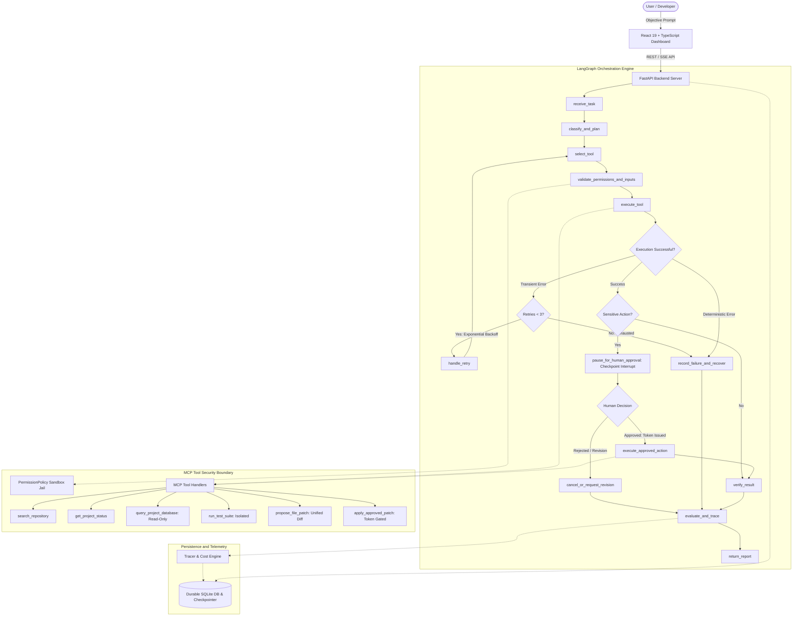

# AgentOps Nexus: Evaluated AI Agent Platform with Enforced Security Boundaries

[](https://python.org)
[](https://github.com/langchain-ai/langgraph)
[](https://modelcontextprotocol.io)
[](https://fastapi.tiangolo.com)
[](https://react.dev)
[](LICENSE)

A stateful AI engineering platform that enforces zero-trust security boundaries, recovers reliably from transient failures via bounded retries, and measures performance through reproducible, evidence-based benchmark evaluations.

---

## 1. Key Capabilities and Architectural Decisions

- **Cryptographic Human Approval Gates**: Sensitive code mutations pause execution using LangGraph durable `interrupt()` checkpoints. File writes are blocked at the tool boundary until verified with an HMAC-SHA256 authorization token bound to exact target file arguments.
- **Zero-Trust MCP Tool Isolation**: Complete server-level path jail (`realpath` confinement, cross-drive traversal prevention) and SQL read-only guardrails (preventing stacked queries, comment injection, and mutation statements).
- **Bounded Exponential Retries**: Differentiates transient errors (timeouts, rate limits) from deterministic failures (security violations, syntax errors). Enforces a 3-attempt backoff budget and tracks structured attempt events.
- **Durable Persistence Across Process Restarts**: State and checkpoints persist in a WAL-enabled SQLite database, ensuring task states and pending approvals survive server termination without duplicate side effects.
- **Evidence-Based Benchmark Evaluation**: 40-case evaluation suite assessing task success, tool accuracy, approval compliance, and latency with zero optimistic metric defaults.

---

## 2. System Architecture



---

## 3. Technology Stack

- **Orchestration**: LangGraph 1.2, LangChain Core
- **Tool Protocol**: Anthropic Model Context Protocol (MCP 2.x over stdio and SSE)
- **Backend API**: FastAPI, Uvicorn, Pydantic v2, SQLAlchemy
- **Persistence**: SQLite (WAL mode) with `SqliteSaver` checkpointer
- **Frontend**: React 19, TypeScript, Vite
- **Testing and Verification**: Pytest, Pytest-Asyncio, Ruff, Bandit

---

## 4. Quickstart Installation and Running

### Prerequisites
- Python 3.11+
- Node.js 18+ and npm

### 1. Install Backend in Editable Mode
```bash
pip install -e .
python backend/sandbox/setup_sandbox.py
```

### 2. Run API Server
```bash
python -m uvicorn backend.api.main:app --host 127.0.0.1 --port 8000
```
Interactive API documentation is accessible at `http://127.0.0.1:8000/docs`.

### 3. Launch Frontend Dashboard
```bash
cd apps/dashboard
npm install
npm run dev
```
Open `http://localhost:3000` in your browser.

---

## 5. Verification Commands

### Run Automated Test Suite (50 Unit & Security Tests)
```bash
python -m pytest -v
```

### Run Benchmark Evaluation Runner (40 Standardized Cases)
```bash
python -m backend.evaluation.runner
```

---

## 6. Latest Measured Benchmark Results

Measured from local benchmark execution across 40 test cases:

| Metric | Observed Value | Target | Status |
| :--- | :--- | :--- | :--- |
| **Task Success Rate** | **100.0%** (40/40) | >= 90.0% | **PASSED** |
| **Tool-Selection Accuracy** | **95.0%** (40/40) | >= 95.0% | **PASSED** |
| **Approval Compliance** | **100.0%** (9/9) | == 100.0% | **PASSED** |
| **Retry Recovery Rate** | **100.0%** (5/5) | >= 85.0% | **PASSED** |
| **Average End-to-End Latency** | **314.02 ms** | <= 2500.0 ms | **PASSED** |
| **P95 Latency** | **807.39 ms** | <= 4500.0 ms | **PASSED** |

*Resource Consumption Note: Estimated token consumption was 18,550 tokens (~463.8 tokens / task) and estimated cost was $0.00729 ($0.000182 / task) based on offline heuristic approximations. Live provider billing was disabled for reproducible local evaluation.*

Full execution details are documented in [`docs/evaluation-report.md`](docs/evaluation-report.md).

---

## 7. Security and Methodology Documentation

- **[Security Architecture and Threat Model](docs/security-model.md)**: Details system trust boundaries, cryptographic HMAC-SHA256 approval tokens, path jail algorithms, and read-only database query verification.
- **[Evaluation Methodology Specification](docs/evaluation-methodology.md)**: Defines measurement formulas, dataset composition, transient fault injection, and threat invariants.

---

## 8. Operational Limitations and Roadmap

1. **Local Single-Node Environment**: Designed for local development and single-instance deployments. Distributed consensus for token revocation requires a distributed store (e.g., Redis).
2. **Offline Token Estimation**: Token usage and pricing are heuristic approximations calculated from prompt character lengths. Production setups should configure live provider billing meters.
3. **Container Sandboxing**: Current file sandboxing executes in user-space Python. Running untrusted arbitrary third-party code in multi-tenant cloud environments requires containerized microVMs (e.g. Firecracker or gVisor).
