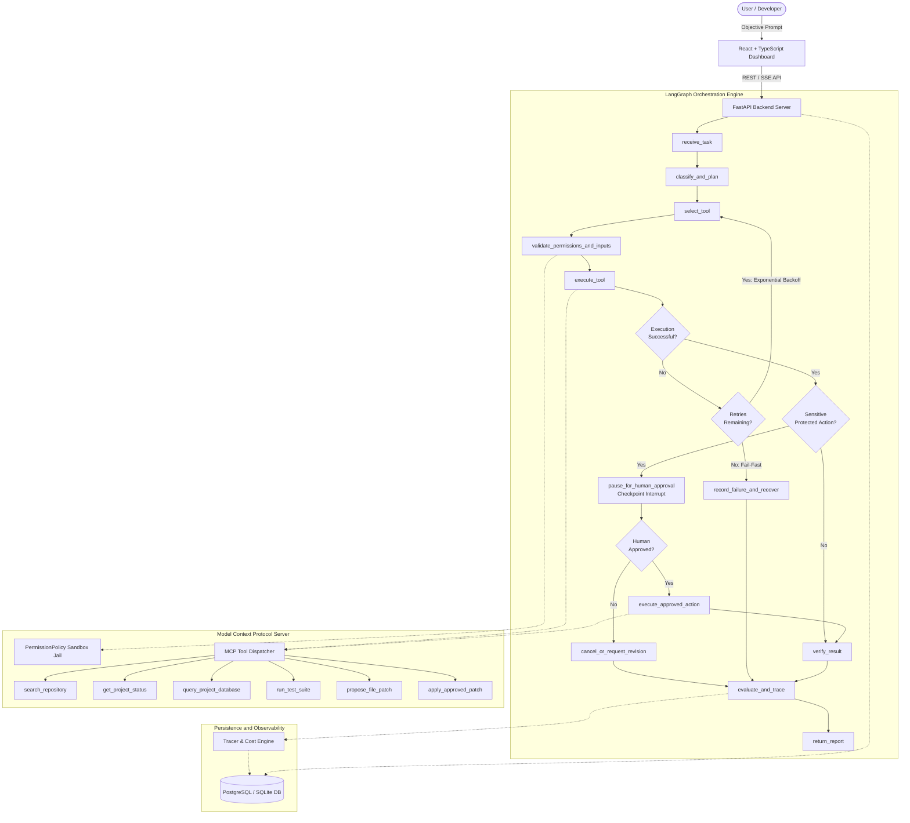

# AgentOps Nexus — Architecture Documentation

AgentOps Nexus is a production-grade AI agent platform unifying stateful LangGraph orchestration, Model Context Protocol (MCP) tool interfaces, human-in-the-loop checkpoint gates, and automated benchmark evaluation.

---

## 1. Core Architectural Pillars

### 1.1 Stateful LangGraph Orchestration
Rather than executing linear single-turn prompts or uncontrolled tool loops, AgentOps Nexus models workflows as explicit state graphs:
- **Shared Typed State (`AgentState`)**: Tracks `task_id`, `objective`, decomposed `plan`, current step pointer, retry counts, `execution_history`, approval payloads, verification outputs, and trace telemetry.
- **Checkpointing & Interrupts**: State transitions are serialized to disk checkpointers. When a sensitive write operation occurs (such as proposing a patch to repository code), the engine calls `interrupt()`, persisting the exact execution pointer without holding active compute threads.
- **Safe Resumption**: Resumed executions accept a cryptographically validated approval token and `Command(resume=...)` payload, resuming directly at `execute_approved_action`.

### 1.2 Model Context Protocol (MCP) Tool Ecosystem
Tools adhere to the Model Context Protocol standard with server-side authorization:
- **Schema Validation**: All tool parameters are strictly validated using Pydantic models.
- **Read-Only by Default**: Database and repository tools reject write attempts unless gated by the protected approval flow.
- **Path Traversal Prison**: Path canonicalization (`os.path.commonpath`) prevents escaping sandbox boundaries.
- **Audit Logging & Secret Redaction**: All tool calls and outputs are recorded with credentials and API tokens masked as `[REDACTED]`.

### 1.3 Observability & Telemetry Engine
- **Hierarchical Spans**: Captures node durations, input/output token counts, and USD cost per model and tool call.
- **LangSmith & OpenTelemetry Compatibility**: Exports standardized execution trees with parent-child span associations.
- **Continuous Evaluation**: Automated runner benchmarks the platform across 40 edge cases spanning normal missions, transient glitches, permission denials, and approval gates.
